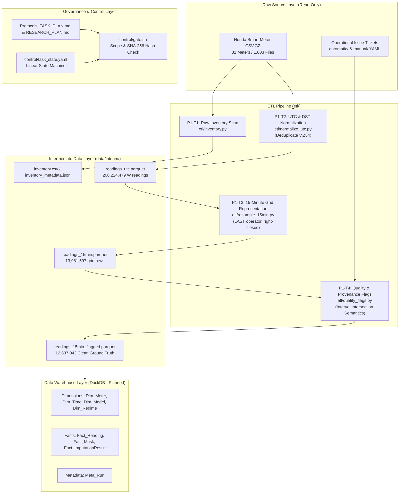

# Beyond Synthetic Missingness: Smart-Meter Imputation Data Warehouse

> **Research Protocol Version**: `v1.1` (Official)  
> **Target Database Engine**: DuckDB (In-process Columnar OLAP)  
> **Source Dataset**: Honda Research Institute Smart-Meter Dataset (2018–2023, Germany)

---

## 1. Project Overview

In time-series imputation benchmarks for smart-meter energy data, researchers conventionally evaluate algorithms using synthetically injected missingness—such as uniform point omissions or uncoordinated random blocks. However, physical power grids experience real, correlated failure episodes characterized by simultaneous outages across hierarchical meter clusters, variable cadence, and multi-day downtime.

**Beyond Synthetic Missingness** is a rigorous data warehousing and experimental benchmarking platform designed to investigate:
> **Core Hypothesis**: Do synthetic missingness benchmarks preserve the relative performance rankings, error magnitudes, and energy conservation properties of imputation algorithms when evaluated against authentic, multi-meter correlated failure episodes in physical power grids?

To resolve this question without methodological distortion or data leakage, the project builds an auditable, constellation-schema data warehouse that tracks the complete research lifecycle—from multi-gigabyte raw sensor ingestion to 4-branch mask generation, baseline/deep-learning model evaluation, and rank sensitivity analysis.

### The 4-Branch Evaluation Framework
1. **S-point (Synthetic Point)**: Random single-point omissions representing transient communication drops.
2. **S-block (Synthetic Block)**: Random continuous missing blocks sampled independently per meter.
3. **S-matched (Synthetic Matched Distribution)**: Synthetic masks matched to the empirical gap-length distribution and missing rate of real failure episodes, but sampled independently per meter (zero cross-meter spatial correlation).
4. **R-derived (Real-Derived Failure Episodes)**: Authentic outage masks extracted from operational issue tickets, preserving cross-meter temporal co-occurrence and electrical network hierarchy.

Direct comparison between **S-matched** and **R-derived** isolates the exact marginal impact of spatial correlation and hierarchy on benchmark validity.

---

## 2. Project Status and Scope

The project follows a 7-phase architecture defined in [`TASK_PLAN.md`](TASK_PLAN.md) and governed by [`RESEARCH_PLAN.md`](RESEARCH_PLAN.md) and [`AGENTS.md`](AGENTS.md):

| Phase | Description | Implemented Scope / Status |
|---|---|---|
| **P1** | **Preprocessing & Warehouse ETL** | **Implemented (T1–T4 Verified)**: Dataset inventory, UTC/DST standardization, 15-minute regular grid representation, and 4-quadrant quality flag labeling. Schema DDL drafted in [`reports/p1_t6_schema_draft.md`](reports/p1_t6_schema_draft.md). Clean segments (T5) and warehouse loading (T7–T8) are planned next. |
| **P2** | **Mask Engine Architecture** | *Planned*: Extraction of failure episodes from operational issue logs and reproducible 4-branch mask generation. |
| **P3** | **Baseline Imputation Benchmark** | *Planned*: Unified benchmarking interface for Linear, Seasonal Naive, KNN, and XGBoost models on clean segments. |
| **P4** | **Ranking & Sensitivity Analysis** | *Planned (MVP Core)*: Kendall rank correlation ($\tau$), bootstrap confidence intervals, and OLAP slicing by gap length, cadence class, and correlation. |
| **P5** | **Deep Learning Imputation** | *Planned (Extension 1)*: SAITS, BRITS, and TimesNet via PyPOTS under strict episode-split protocols. |
| **P6** | **Context-Aware Dynamic Selector** | *Conditional (Extension 2)*: Triggered only if P4 decision gate detects significant regime-dependent ranking shifts. |
| **P7** | **Analytics Dashboard & Reporting** | *In Progress / Planned*: Analytical reporting, reproducible execution package, and Power BI dashboard. |

---

## 3. Key Implemented Features

- **Strict Research Governance & Quality Gates**: Automated gatekeeper ([`control/gate.sh`](control/gate.sh)) enforcing SHA-256 protocol integrity ([`control/protocol_hash.sh`](control/protocol_hash.sh)), scope boundary discipline ([`control/check_scope.py`](control/check_scope.py)), and linear task progression ([`control/task_state.yaml`](control/task_state.yaml)).
- **External Dataset Path Resolution**: Robust, read-only configuration loader ([`src/config.py`](src/config.py)) that resolves local paths, spaces in directory names, and external storage mounts without modifying raw data.
- **Authoritative Dataset Census (P1-T1)**: Complete inventory of 81 meters, 1,603 raw files, and over 3.95 billion cumulative readings spanning 2017-12-30 to 2024-01-01 ([`etl/inventory.py`](etl/inventory.py)).
- **Deterministic UTC & DST Normalization (P1-T2)**: Vectorized timestamp alignment preserving local wall-clock time (`Europe/Berlin`), DST transition flags, and zero-synthetic observation integrity while resolving 61,790 duplicate records isolated to `V.Z84` ([`etl/normalize_utc.py`](etl/normalize_utc.py)).
- **15-Minute Regular Grid Representation (P1-T3)**: Standardized quarter-hour grid $(t - 15\text{min}, t]$ via deterministic right-closed `LAST` operator, preserving all occupied bins and 79 core active energy ($W$) meters without synthetic interpolation ([`etl/resample_15min.py`](etl/resample_15min.py)).
- **4-Quadrant Quality & Provenance Flags (P1-T4)**: Rigorous interval-intersection semantics ($\text{Bin}(t) \cap I \neq \emptyset \iff s \le t \land e > t - 15\text{min}$) matching 88 issue logs into clean observed ground truth (12,637,042 rows), issue-observed rows (696,535), unrelated observation gaps (527,756), and corroborated outage gaps (120,264) ([`etl/quality_flags.py`](etl/quality_flags.py)).
- **Automated Verification Suite**: 65 unit and integration tests covering data consistency, boundary semantics, immutability, and anti-leakage invariants.

---

## 4. Technology Stack

| Technology / Tool | Version | Role in Project |
|---|---|---|
| **Python** | `>= 3.12` | Core programming language for pipeline, ETL, and validation |
| **PyArrow** | `25.0.1` | High-performance columnar data processing, Parquet streaming, and memory-bounded I/O |
| **Pandas** | `3.0.6` | Tabular data manipulation, time series indexing, and metadata aggregation |
| **NumPy** | `2.5.3` | Vectorized numerical operations and array manipulation |
| **PyYAML** | `6.0.3` | Configuration management and issue ticket parsing |
| **Pytest** | `9.1.1` | Automated test suite execution and invariant assertion |
| **DuckDB** | *Target DBMS* | In-process analytical columnar DBMS for warehouse constellation schema |
| **Bash & Git** | *Standard* | Shell automation, protocol SHA-256 verification, and change tracking |

---

## 5. Architecture and Data Workflow



### Core Invariants
1. **Protected Raw Data**: `data/raw/` is strictly read-only; scripts never modify source files.
2. **Ground Truth Authenticity**: Corrected records (`_corrected_raw` from inverted CT sensors) are strictly excluded from ground truth. Ground truth is extracted only from uncompromised clean segments.
3. **Zero Synthetic Observations**: The downsampling grid preserves bit-for-bit raw sensor values selected via the `LAST` operator. No mathematical smoothing, averaging, or artificial interpolation is performed during ETL.
4. **Occupied Bin Preservation**: Every 15-minute grid bin containing $\ge 1$ observation yields exactly one non-null record ($count(\text{non\_nan\_15min}) == count(\text{raw\_occupied\_bins})$).
5. **Anti-Feature Leakage**: Raw record counts and bin completeness metrics are stored exclusively as descriptive audit metadata. They are strictly prohibited as input features for imputation models.

---

## 6. Repository Structure

```text
data-warehousing/
├── AGENTS.md                       # Single Source of Governance & research protocols
├── TASK_PLAN.md                    # Single Source of Truth: task specifications & criteria
├── RESEARCH_PLAN.md                # Scientific research protocol & mathematical definitions
├── AUDITOR.md                      # Audit standards and independent verification procedures
├── EXECUTOR.md                     # Implementation guidelines for engineering agents
├── REPAIR.md                       # Protocol amendment and remediation workflows
├── requirements.txt                # Python package dependencies
│
├── configs/                        # Pipeline configuration
│   ├── README.md                   # Configuration and path resolution guide
│   ├── default.yaml                # Default pipeline configuration template
│   ├── local.yaml.example          # Machine-specific template (for external dataset paths)
│   └── local.yaml                  # [Ignored] Active local configuration
│
├── control/                        # Automated research governance and quality gate
│   ├── README.md                   # Control layer documentation
│   ├── gate.sh                     # Automated pre-flight quality gate script
│   ├── check_scope.py              # Scope enforcement against protected paths
│   ├── validate_state.py           # State machine validator for task_state.yaml
│   ├── protocol_hash.sh            # SHA-256 protocol integrity generator & checker
│   ├── protocol_hashes.txt         # Checksum manifest for immutable protocol documents
│   ├── protected_paths.txt         # Manifest of files protected from executor modification
│   └── task_state.yaml             # Lifecycle state tracker across tasks
│
├── src/                            # Core shared utilities
│   ├── __init__.py
│   └── config.py                   # Central configuration and external path loader
│
├── etl/                            # Extraction, transformation, and processing scripts
│   ├── __init__.py
│   ├── config.py                   # ETL configuration bridge
│   ├── inventory.py                # P1-T1: Raw dataset inventory and sensor census
│   ├── normalize_utc.py            # P1-T2: Timezone, DST, and timestamp standardization
│   ├── resample_15min.py           # P1-T3: Standardized 15-minute regular grid representation
│   └── quality_flags.py            # P1-T4: Data quality, issue interval, and ground truth flags
│
├── analysis/                       # Analysis and verification utilities
│   └── crosscheck_reduced_15min.py # Cross-check reconciliation between raw and 15-minute grids
│
├── tests/                          # Automated test suite (65 tests)
│   ├── test_control_layer.py       # Gatekeeper, scope enforcement, and state tests
│   ├── test_external_raw_config.py # External path resolution and space handling tests
│   ├── test_P1_T1.py               # P1-T1 Inventory acceptance tests
│   ├── test_P1_T2.py               # P1-T2 UTC normalization & deduplication tests
│   ├── test_P1_T3.py               # P1-T3 15-minute grid & regularity tests
│   └── test_P1_T4.py               # P1-T4 Quality flags & boundary intersection tests
│
├── data/                           # Data storage directory (Parquet files gitignored)
│   ├── raw/                        # Default mount point for raw Honda dataset (read-only)
│   ├── interim/                    # Standardized Parquet files and inventory summaries
│   ├── processed/                  # Clean segments and evaluation splits (planned)
│   └── audit_results/              # Independent audit reports and repair logs
│
├── reports/                        # Task logs, reconciliation reports, and architectural drafts
│   ├── p1_inventory.md             # Dataset inventory report
│   ├── p1_t6_schema_draft.md       # DuckDB warehouse schema design document
│   ├── p1_t6_erd_draft.png         # Warehouse Entity-Relationship Diagram draft
│   └── ...                         # Task execution logs and protocol amendments
│
└── audits/                         # Signed audit reports per task (AUDIT_P1_T1..T4)
```

---

## 7. Prerequisites and Installation

### Prerequisites
- Linux OS (tested on Ubuntu/Debian-compatible distributions)
- Python `3.12` or higher
- Bash shell and Git

### Setup Steps

1. **Clone the repository**:
   ```bash
   git clone <repository-url>
   cd data-warehousing
   ```

2. **Create and activate a virtual environment**:
   ```bash
   python3 -m venv .venv
   source .venv/bin/activate
   ```

3. **Install dependencies**:
   ```bash
   pip install -r requirements.txt
   ```

4. **Configure external dataset path**:
   If the raw Honda dataset is located on an external drive or custom folder, create `configs/local.yaml`:
   ```bash
   cp configs/local.yaml.example configs/local.yaml
   ```
   Edit `configs/local.yaml` to set your absolute path:
   ```yaml
   protocol_version: "v1.1"

   data:
     raw_dir: "/path/to/your/Honda_Dataset"
     interim_dir: "data/interim"
     processed_dir: "data/processed"
   ```

5. **Validate configuration and dataset presence**:
   ```bash
   python3 -m src.config --validate
   ```

---

## 8. Usage

All scripts accept `--config <path>` to specify a configuration file, falling back automatically to `configs/local.yaml` then `configs/default.yaml`.

### 1. Run Raw Dataset Inventory (P1-T1)
Scans all meters and files, verifying data integrity and row counts:
```bash
python3 etl/inventory.py
```
*Outputs*: [`data/interim/inventory.csv`](data/interim/inventory.csv), [`data/interim/inventory_metadata.json`](data/interim/inventory_metadata.json), and [`reports/p1_inventory.md`](reports/p1_inventory.md).

### 2. Standardize UTC & DST Timestamps (P1-T2)
Extracts active energy ($W$) series, standardizes timestamps to canonical UTC with `Europe/Berlin` local mappings, and deduplicates records:
```bash
python3 etl/normalize_utc.py
```
*Outputs*: `data/interim/readings_utc.parquet` (208,224,479 rows) and run metadata JSON.

### 3. Generate 15-Minute Regular Grid (P1-T3)
Constructs the quarter-hour grid representation using the right-closed `LAST` operator:
```bash
python3 etl/resample_15min.py
```
*Outputs*: `data/interim/readings_15min.parquet` (13,981,597 grid rows across 79 meters).

### 4. Attach Quality Flags & Identify Ground Truth (P1-T4)
Maps operational issue logs to grid intervals and marks uncompromised ground truth:
```bash
python3 etl/quality_flags.py
```
*Outputs*: `data/interim/readings_15min_flagged.parquet` and [`data/interim/readings_15min_flagged_metadata.json`](data/interim/readings_15min_flagged_metadata.json).

---

## 9. Data Model & Population Rules

### Core Research Population (Protocol v1.1)
To ensure objective, unbiased evaluation, meter retention is defined by a deterministic rule specified prior to model training:
$$\text{CoreEligible}(m) \iff \text{history\_days}(m) \ge 365 \land \text{median\_gap}(m) \le 900\text{s} \land \text{occupied\_rate}(m) \ge 0.50 \land \text{var}(m) = \text{'W'}$$
- **Retention**: **79 of 79 available $W$ meters** satisfy the rule and are retained in the core population.
- **Meter `H1.ZE20`**: Retained with 396.61 days history (~397 days). Downstream train/test splits must not evaluate `H1.ZE20` before its installation date (2022-11-30).

### Four-Quadrant Quality Distribution (P1-T4 Census)
Across 13,981,597 grid rows:
- **$Q_1$ Clean Observed (`is_valid_ground_truth = True`)**: **12,637,042 rows (90.38%)** — Valid observations outside any outage interval.
- **$Q_2$ Issue Observed (`!missing & has_issue`)**: **696,535 rows (4.98%)** — Observations recorded during equipment/transformer outage tickets.
- **$Q_3$ Unrelated Observation Gap (`missing & !has_issue`)**: **527,756 rows (3.77%)** — Communication gaps without reported physical failure.
- **$Q_4$ Corroborated Outage Gap (`missing & has_issue`)**: **120,264 rows (0.86%)** — Authentic outages confirmed by issue logs.

### Warehouse Target Schema (DuckDB Constellation)
As documented in [`reports/p1_t6_schema_draft.md`](reports/p1_t6_schema_draft.md):
- **Dimensions**: `Dim_Meter` (cadence, hierarchy, load type), `Dim_Time` (15-min calendar, DST), `Dim_Model` (algorithm parameters), `Dim_Regime` (gap/correlation categories).
- **Facts**: `Fact_Reading` (standardized series with quality flags), `Fact_FailureEpisode` (outage tickets), `Fact_Mask` (4-branch evaluation masks), `Fact_ImputationResult` (MAE, RMSE, kWh energy bias), `Fact_ForecastResult` (downstream error).
- **Audit Metadata**: `Meta_Run` (`run_id`, `seed`, `git_commit`, `config_hash`, timestamps).

---

## 10. Testing and Validation

The repository includes a comprehensive, automated test suite in [`tests/`](tests/).

### Running the Test Suite
Execute all tests using `pytest` within the project virtual environment:
```bash
pytest -v
```

### Validation Coverage
- **Control Layer (`tests/test_control_layer.py`)**: Validates protected path detection, raw data immutability, protocol SHA-256 repeatability, gate failure on scope violations, and state machine transitions (7 tests).
- **Configuration & External Path (`tests/test_external_raw_config.py`)**: Tests config parsing, space-containing paths, path existence checks, read-only permissions, and Honda dataset structural signatures (8 tests).
- **Inventory (`tests/test_P1_T1.py`)**: Asserts all 81 meters are scanned, raw file counts match, row sums match, and raw files remain unmodified (8 tests).
- **UTC Normalization (`tests/test_P1_T2.py`)**: Asserts UTC timestamps, spring/fall DST transitions, absence of duplicate timestamps per meter, correct handling of empty files, exclusion of `_corrected_raw` files, and reconciliation of `V.Z84` duplicate readings (12 tests).
- **15-Minute Grid Representation (`tests/test_P1_T3.py`)**: Tests quarter-hour regularity, ceiling boundary rules (`ceil_to_15min` on max timestamp), `LAST` representative selection, empty bin NaN semantics, occupied bin preservation, bit-for-bit zero synthetic values, and cadence classification (14 tests).
- **Quality Flags (`tests/test_P1_T4.py`)**: Validates 4-quadrant counts, boundary-start ($s = t$) and open-left-boundary ($e = t - 15\text{min}$) set intersection semantics, zero-duration point event preservation, bit-for-bit value checksum identity, and ground truth purity (15 tests).

*Status*: **All 65 tests currently pass (100% passing rate).**

### Running the Quality Gate
Before handing over code or advancing task states, run the automated quality gate:
```bash
bash control/gate.sh
```

---

## 11. Known Limitations and Troubleshooting

1. **Large Dataset Storage & Memory**:
   The full raw dataset comprises ~3.95 billion sensor readings. Running `etl/inventory.py` or `etl/normalize_utc.py` from scratch performs out-of-core streaming and takes significant time. Intermediate Parquet files (`data/interim/*.parquet`) total ~800 MB and are excluded from Git via `.gitignore`.
2. **Missing `numpy` / Dependencies in Standalone Pytest**:
   If executing `pytest` yields `ModuleNotFoundError: No module named 'numpy'`, ensure you run with the virtual environment activated (`source .venv/bin/activate` or `.venv/bin/pytest`).
3. **Empty Source Files**:
   Three files in the raw dataset (`H2.T.Z33.WQ_raw.csv.gz`, `H3.Z41.WQ_raw.csv.gz`, `H3.Z42.W_raw.csv.gz`) contain headers only (zero data rows). The ETL pipeline explicitly handles these without crashing or generating synthetic observations.
4. **Scope Check on Uncommitted Repositories**:
   `control/gate.sh` inspects the working tree via Git. In a fresh clone or uncommitted repository, untracked protected files may trigger a scope notice until the initial commit or tracking branch is configured.

---

## 12. Contributing and Development Guidelines

This project strictly adheres to the research governance rules in [`AGENTS.md`](AGENTS.md):
- **Single Task Focus**: Work on one task at a time as recorded in [`control/task_state.yaml`](control/task_state.yaml).
- **Protocol Immutability**: Do not modify definitions or thresholds in [`TASK_PLAN.md`](TASK_PLAN.md) or [`RESEARCH_PLAN.md`](RESEARCH_PLAN.md). Any proposed protocol changes require a formal amendment documented in `audits/` and ratified by the Protocol Owner.
- **No Test Alteration**: Tests encode research acceptance criteria. Never modify assertions to make a test pass.
- **Reproducibility**: All experiment scripts must support `--seed` and `--config` CLI flags and log executions to `Meta_Run`.
- **Pre-Commit Verification**: Run `bash control/gate.sh` and ensure all tests pass before submitting changes.

---

## 13. Acknowledgments and Attribution

- **Dataset**: Research dataset collected and published by the **Honda Research Institute Europe** (smart energy and building metering system, Offenbach am Main, Germany).
- **Academic Context**: University data warehousing research curriculum (VKU - Vietnam-Korea University of Information and Communication Technology). Detailed course syllabus and references are located in [`documents/`](documents/).
