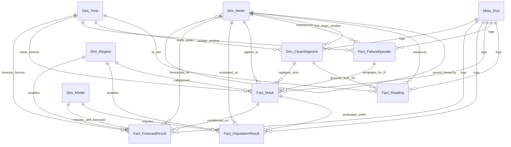

# Báo Cáo Thiết Kế Chi Tiết Warehouse Schema (P1-T6 Schema Draft)

> **Dự án**: Beyond Synthetic Missingness — Smart-Meter Imputation  
> **Chế độ**: `P1-T6 PREPARATION — Warehouse Schema Design ONLY` (Bản thiết kế tiền trạm, không phải nghiệm thu chính thức P1-T6)  
> **Động cơ lưu trữ**: DuckDB (In-process OLAP Columnar DBMS)  
> **Tài liệu căn cứ**: [`TASK_PLAN.md`](file:///home/duck/Downloads/Vice%20-%20Download/StudyWithVKU/StudyWithVKU/ThirdYear/data-warehousing/TASK_PLAN.md) (mục 0.2), [`AGENTS.md`](file:///home/duck/Downloads/Vice%20-%20Download/StudyWithVKU/StudyWithVKU/ThirdYear/data-warehousing/AGENTS.md), [`AUDITOR.md`](file:///home/duck/Downloads/Vice%20-%20Download/StudyWithVKU/StudyWithVKU/ThirdYear/data-warehousing/AUDITOR.md), [`reports/p1_inventory.md`](file:///home/duck/Downloads/Vice%20-%20Download/StudyWithVKU/StudyWithVKU/ThirdYear/data-warehousing/reports/p1_inventory.md)  
> **Sơ đồ ERD đi kèm**: [`reports/p1_t6_erd_draft.png`](file:///home/duck/Downloads/Vice%20-%20Download/StudyWithVKU/StudyWithVKU/ThirdYear/data-warehousing/reports/p1_t6_erd_draft.png)  
> **Thời điểm lập**: 2026-10-05  

---

## 1. Triết lý Thiết Kế & Ràng Buộc Bất Biến (Design Philosophy & Invariants)

Kho dữ liệu của dự án được xây dựng theo mô hình **Chòm sao dữ liệu đa chiều (Constellation / Galaxy Schema)** trên nền tảng **DuckDB**. Khác với các hệ thống OLTP thông thường, warehouse này đóng vai trò "xương sống" cho toàn bộ vòng đời nghiên cứu (từ tiền xử lý, trích xuất sự cố, sinh mask, huấn luyện baseline & deep learning, đến kiểm định ranking bootstrap và downstream forecasting).

### 1.1. Các nguyên tắc thiết kế cốt lõi
1. **Phân lập tuyệt đối Ground Truth (Ground Truth Isolation Guard)**:
   - Dữ liệu `corrected` từ cảm biến đảo pha CT tuyệt đối không được phép vô tình trở thành ground truth.
   - Ground truth chỉ được trích xuất từ các cửa sổ sạch hợp lệ (`clean segment`). Bảng `Fact_Reading` tích hợp cờ bảo vệ `is_valid_ground_truth` và tách biệt vật lý giữa `raw_value`, `corrected_value` và `clean_ground_truth_value`.
2. **Khả năng truy xuất nguồn gốc tối đa (Full Provenance Traceability)**:
   - Mọi dòng dữ liệu đọc (`Fact_Reading`) đều giữ liên kết về file nguồn thô (`raw_source_file` khi có điểm đo vật lý, hoặc NULL khi là điểm missing/gap trên lưới 15 phút), số bản ghi gốc được gom và mã lần chạy ETL (`run_id`).
   - Mọi kết quả khôi phục (`Fact_ImputationResult`) và dự báo phụ tải (`Fact_ForecastResult`) đều truy ngược chính xác về `mask_id`, `model_id`, `meter_id`, và `run_id` trong `Meta_Run`.
3. **Tính tái lập khoa học nghiêm ngặt (Scientific Reproducibility)**:
   - Bảng `Meta_Run` lưu vết đầy đủ: `seed`, `data_version`, `config_hash` (SHA-256), `git_commit`, thời gian UTC, và cấu hình thực thi.
   - Bảng `Fact_Mask` lưu trữ `random_seed` và `bitmask_hash` (SHA-256 của mảng nhị phân 0/1) để đảm bảo kiểm thử bit-for-bit không thay đổi giữa các lần chạy.
4. **Ngăn chặn rò rỉ dữ liệu (No-Leakage by Construction)**:
   - Thiết kế khóa ngoại và cấu trúc bảng bảo đảm không thể trộn lẫn các episode giữa tập huấn luyện và kiểm thử.
   - `Fact_Mask` được định nghĩa độc lập với giá trị đo lường thực tế, chỉ bao gồm thông tin vị trí thời gian và độ dài gap.

---

## 2. Danh Mục & Chi Tiết Các Bảng Trong Warehouse

Warehouse bao gồm 11 thực thể logic (4 Dimension, 5 Fact, 1 Metadata theo mục 0.2 của `TASK_PLAN.md`, cùng 1 Dimension/Bridge hỗ trợ là `Dim_CleanSegment` nhằm đóng vai trò mỏ neo chứng thực cho Ground Truth).

| Phân loại | Tên bảng | Hạt dữ liệu (Granularity) | Số dòng ước tính | Vai trò trong nghiên cứu |
|---|---|---|---|---|
| **Metadata** | `Meta_Run` | 1 dòng / 1 lần chạy script hoặc task pipeline | 100 – 1,000 dòng | Lưu vết provenance, seed, git commit, config hash |
| **Dimension** | `Dim_Meter` | 1 dòng / 1 đồng hồ (meter) hoặc cảm biến | 81 dòng (toàn bộ dataset) | Cấu trúc phân cấp tòa nhà, loại phụ tải, điện áp |
| **Dimension** | `Dim_Time` | 1 dòng / 1 bước lưới 15 phút (2017–2024) | ~210,500 dòng | Trục thời gian chuẩn, UTC, local Europe/Berlin, DST, lịch nghỉ |
| **Dimension** | `Dim_Model` | 1 dòng / 1 thuật toán imputation hoặc downstream | 10 – 30 dòng | Phân loại baseline, ML, Deep Learning (PyPOTS), Oracle |
| **Dimension** | `Dim_Regime` | 1 dòng / 1 kịch bản missingness (branch × gap × corr) | 20 – 50 dòng | Phân loại kịch bản missing phục vụ phân tích OLAP P4 |
| **Dimension / Bridge** | `Dim_CleanSegment` | 1 dòng / 1 đoạn sạch liên tục $\ge L_{min}$ | 500 – 5,000 dòng | **Mỏ neo Ground Truth**, xác định vùng an toàn để replay mask |
| **Fact** | `Fact_Reading` | 1 dòng / 1 meter / 1 bước lưới 15 phút | ~17.05 triệu dòng | Chuỗi thời gian chuẩn hóa 15 phút kèm 3 cờ chất lượng |
| **Fact** | `Fact_FailureEpisode` | 1 dòng / 1 sự cố thực tế từ issue logs | 1,000 – 10,000 dòng | Kho sự cố thực tế: thời gian, độ dài, nhóm correlated |
| **Fact** | `Fact_Mask` | 1 dòng / 1 trường hợp mask thí nghiệm (4 nhánh) | 10,000 – 100,000 dòng | Thư viện mask (S-point, S-block, S-matched, R-derived) |
| **Fact** | `Fact_ImputationResult` | 1 dòng / 1 lượt đánh giá (run × model × mask) | 50,000 – 500,000 dòng | Metric sai số khôi phục: MAE, RMSE, sai lệch năng lượng |
| **Fact** | `Fact_ForecastResult` | 1 dòng / 1 lượt dự báo downstream (P6-T5) | 10,000 – 100,000 dòng | Đánh giá sai số dự báo phụ tải sau khi điền khuyết |

---

### 2.1. `Meta_Run` (Bảng Quản Lý Tiến Trình & Khả Năng Tái Lập)

* **Mục đích**: Đảm bảo nguyên tắc số 6 trong `AGENTS.md`: Mọi lần chạy phát sinh dữ liệu đều ghi vết đầy đủ để có thể tái lập 100%.

| Tên cột | Kiểu dữ liệu | Nullable | Khóa | Ràng buộc / Giá trị mặc định | Diễn giải nghiệp vụ |
|---|---|:---:|:---:|---|---|
| `run_id` | `VARCHAR(64)` | NOT NULL | **PK** | — | Định danh duy nhất của lần chạy (UUIDv4 hoặc Hash) |
| `task_id` | `VARCHAR(20)` | NOT NULL | — | — | Mã task thực thi (ví dụ: `'P1-T7'`, `'P2-T4'`, `'P3-T6'`) |
| `stage_id` | `VARCHAR(10)` | NOT NULL | — | `CHECK (stage_id IN ('P1','P2','P3','P4','P5','P6','P7'))` | Giai đoạn nghiên cứu tương ứng |
| `seed` | `INTEGER` | NOT NULL | — | — | Random seed cố định lấy từ CLI/config |
| `data_version` | `VARCHAR(50)` | NOT NULL | — | — | Phiên bản dữ liệu (vd: `'Honda-SmartMeter-2018-2023-v1.0'`) |
| `config_hash` | `VARCHAR(64)` | NOT NULL | — | — | SHA-256 hash của nội dung file config YAML sử dụng |
| `git_commit` | `VARCHAR(40)` | NOT NULL | — | — | Mã Git commit SHA tại thời điểm chạy |
| `run_timestamp_utc` | `TIMESTAMPTZ` | NOT NULL | — | `DEFAULT CURRENT_TIMESTAMP` | Thời điểm bắt đầu thực thi theo giờ chuẩn UTC |
| `execution_duration_sec` | `DOUBLE` | NULL | — | `CHECK (execution_duration_sec >= 0.0)` | Tổng thời gian chạy thực tế tính bằng giây |
| `status` | `VARCHAR(20)` | NOT NULL | — | `CHECK (status IN ('RUNNING','SUCCESS','FAILED','ABORTED'))` | Trạng thái hoàn thành của run |
| `cli_command` | `VARCHAR(500)` | NULL | — | — | Lệnh CLI đầy đủ kèm tham số đã thực thi |
| `host_environment` | `VARCHAR(100)` | NULL | — | — | Thông tin môi trường máy chủ (OS, CPU, GPU) |
| `notes` | `VARCHAR(1000)` | NULL | — | — | Ghi chú bổ sung hoặc lý do dừng nếu failed |

* **Chỉ mục (Indexes)**:
  - `idx_meta_run_task_seed`: `CREATE INDEX idx_meta_run_task_seed ON Meta_Run(task_id, seed, config_hash);`
  - `idx_meta_run_timestamp`: `CREATE INDEX idx_meta_run_timestamp ON Meta_Run(run_timestamp_utc);`
* **Lý do thiết kế**: Đóng gói toàn diện provenance vào một bảng duy nhất, làm gốc tham chiếu cho mọi Fact table.

---

### 2.2. `Dim_Meter` (Chiều Phân Cấp Hệ Thống Đồng Hồ)

* **Mục đích**: Biểu diễn toàn diện danh mục 81 đồng hồ đo, mối quan hệ phân cấp không gian từ nguồn phát trung thế (`V`), các nhánh biến áp (`H2.T`), đến từng lộ đo tiêu thụ theo tòa nhà (`H1`, `H2`, `H3`, `H4`) và trạm thời tiết (`WeatherStation`).

| Tên cột | Kiểu dữ liệu | Nullable | Khóa | Ràng buộc / Giá trị mặc định | Diễn giải nghiệp vụ |
|---|---|:---:|:---:|---|---|
| `meter_id` | `VARCHAR(50)` | NOT NULL | **PK** | — | Mã meter chính thức (vd: `'H1.Z10'`, `'H2.T.Z30'`, `'V.Z81'`) |
| `meter_code` | `VARCHAR(50)` | NOT NULL | **UQ** | — | Khóa tự nhiên (Natural Key) từ hệ thống nguồn |
| `building_id` | `VARCHAR(20)` | NOT NULL | — | `CHECK (building_id IN ('H1','H2','H3','H4','V','WeatherStation'))` | Tòa nhà hoặc khu vực phân phối |
| `section_id` | `VARCHAR(50)` | NULL | — | — | Phân đoạn bảng điện (ví dụ: `'H2.T'` trạm biến áp trung gian) |
| `parent_meter_id` | `VARCHAR(50)` | NULL | **FK** | `REFERENCES Dim_Meter(meter_id)` | Khóa tự tham chiếu trỏ về meter cấp cha (Adjacency List) |
| `hierarchy_level` | `SMALLINT` | NOT NULL | — | `CHECK (hierarchy_level BETWEEN 0 AND 3)` | Cấp phân cấp: 0=Site, 1=Main Incomer, 2=Substation, 3=Sub-meter |
| `hierarchy_path` | `VARCHAR(255)` | NOT NULL | — | — | Chuỗi đường dẫn phân cấp (vd: `'/V/H2/H2.T/H2.T.Z30'`) |
| `meter_type` | `VARCHAR(30)` | NOT NULL | — | `CHECK (meter_type IN ('Electricity','Thermal','Weather'))` | Loại môi chất/đại lượng đo lường chính |
| `load_category` | `VARCHAR(50)` | NOT NULL | — | — | Nhóm tải (vd: `'HVAC'`, `'Lighting'`, `'EV_Charging'`, `'Main_Feed'`) |
| `phase_count` | `SMALLINT` | NULL | — | `CHECK (phase_count IN (1, 3))` | Số pha điện đo lường (1 pha hoặc 3 pha) |
| `nominal_voltage_v` | `DOUBLE` | NULL | — | — | Điện áp định mức (vd: 230V, 400V) |
| `native_frequency` | `VARCHAR(20)` | NOT NULL | — | `CHECK (native_frequency IN ('15s','30s','1min','2min'))` | Tần suất phát tín hiệu gốc đã kiểm kê tại P1-T1 |
| `is_pilot` | `BOOLEAN` | NOT NULL | — | `DEFAULT FALSE` | Cờ đánh dấu thuộc tập pilot (~10–20 meters cho P3-T1) |
| `has_ct_inversion_history` | `BOOLEAN` | NOT NULL | — | `DEFAULT FALSE` | Cờ đánh dấu meter có lịch sử đảo pha CT (vd: `V.ZE84`) |
| `description` | `VARCHAR(255)` | NULL | — | — | Mô tả chức năng và vị trí lắp đặt thực tế |

* **Chỉ mục (Indexes)**:
  - `idx_dim_meter_building_level`: `CREATE INDEX idx_dim_meter_building_level ON Dim_Meter(building_id, hierarchy_level);`
  - `idx_dim_meter_parent`: `CREATE INDEX idx_dim_meter_parent ON Dim_Meter(parent_meter_id);`
  - `idx_dim_meter_type_load`: `CREATE INDEX idx_dim_meter_type_load ON Dim_Meter(meter_type, load_category);`
* **Lý do thiết kế**: Hỗ trợ đồng thời 2 mô hình truy vấn phân cấp:
  1. *Adjacency List* qua `parent_meter_id` phục vụ đệ quy CTE tìm nhánh cây sự cố.
  2. *Flattened Attributes* (`hierarchy_level`, `hierarchy_path`) phục vụ OLAP roll-up và Group-by đa chiều tốc độ cao trong DuckDB mà không cần JOIN đệ quy.

---

### 2.3. `Dim_Time` (Chiều Thời Gian Lưới 15 Phút)

* **Mục đích**: Chuẩn hóa toàn bộ dòng thời gian ~6 năm thành lưới đều đặn 15 phút. Giải quyết dứt điểm sự chênh lệch múi giờ UTC, giờ địa phương Đức (`Europe/Berlin`), chuyển đổi giờ mùa hè/mùa đông (DST transitions), ngày nghỉ lễ và tính chu kỳ ngày đêm.

| Tên cột | Kiểu dữ liệu | Nullable | Khóa | Ràng buộc / Giá trị mặc định | Diễn giải nghiệp vụ |
|---|---|:---:|:---:|---|---|
| `time_id` | `BIGINT` | NOT NULL | **PK** | — | Khóa số chuẩn hóa tính từ UTC: `strftime(timestamp_utc, '%Y%m%d%H%M')::BIGINT` |
| `timestamp_utc` | `TIMESTAMP` | NOT NULL | **UQ** | — | Mốc thời gian chuẩn UTC (đơn điệu tuyệt đối, độ phân giải microsecond) |
| `timestamp_local` | `TIMESTAMP` | NOT NULL | — | — | Mốc thời gian địa phương Đức (Wall-clock time `Europe/Berlin`, xử lý DST) |
| `date_local` | `DATE` | NOT NULL | — | — | Ngày lịch địa phương Đức (vd: `2018-01-01`) |
| `year` | `SMALLINT` | NOT NULL | — | `CHECK (year BETWEEN 2017 AND 2025)` | Năm dương lịch địa phương |
| `quarter` | `SMALLINT` | NOT NULL | — | `CHECK (quarter BETWEEN 1 AND 4)` | Quý trong năm (1–4) |
| `month` | `SMALLINT` | NOT NULL | — | `CHECK (month BETWEEN 1 AND 12)` | Tháng trong năm (1–12) |
| `month_name` | `VARCHAR(15)` | NOT NULL | — | — | Tên tháng tiếng Anh (vd: `'January'`) |
| `week_of_year` | `SMALLINT` | NOT NULL | — | `CHECK (week_of_year BETWEEN 1 AND 53)` | Số tuần theo chuẩn ISO 8601 |
| `day_of_month` | `SMALLINT` | NOT NULL | — | `CHECK (day_of_month BETWEEN 1 AND 31)` | Ngày trong tháng |
| `day_of_week` | `SMALLINT` | NOT NULL | — | `CHECK (day_of_week BETWEEN 1 AND 7)` | Thứ trong tuần (1=Thứ 2, 7=Chủ nhật theo ISO) |
| `day_name` | `VARCHAR(15)` | NOT NULL | — | — | Tên thứ trong tuần (vd: `'Monday'`) |
| `is_weekend` | `BOOLEAN` | NOT NULL | — | — | Cờ cuối tuần (TRUE nếu Thứ 7 hoặc Chủ Nhật) |
| `is_holiday` | `BOOLEAN` | NOT NULL | — | — | Cờ ngày nghỉ lễ bang Hessen, Đức (tác động lớn tới phụ tải) |
| `season` | `VARCHAR(10)` | NOT NULL | — | `CHECK (season IN ('Winter','Spring','Summer','Autumn'))` | Mùa khí tượng |
| `hour_local` | `SMALLINT` | NOT NULL | — | `CHECK (hour_local BETWEEN 0 AND 23)` | Giờ địa phương Đức (0–23) phản ánh đúng chu kỳ sinh hoạt |
| `hour_utc` | `SMALLINT` | NOT NULL | — | `CHECK (hour_utc BETWEEN 0 AND 23)` | Giờ chuẩn UTC (0–23) |
| `minute` | `SMALLINT` | NOT NULL | — | `CHECK (minute IN (0, 15, 30, 45))` | Phút trên lưới 15 phút |
| `time_of_day_slot` | `SMALLINT` | NOT NULL | — | `CHECK (time_of_day_slot BETWEEN 0 AND 95)` | Thứ tự khung 15 phút theo giờ local ($hour\_local \times 4 + minute/15$) |
| `day_phase` | `VARCHAR(20)` | NOT NULL | — | — | Pha phụ tải theo giờ local (`'Night'`, `'Morning_Peak'`, `'Midday'`, `'Evening_Peak'`) |
| `utc_offset_hours` | `SMALLINT` | NOT NULL | — | `CHECK (utc_offset_hours IN (1, 2))` | Độ lệch UTC (+1 mùa đông CET, +2 mùa hè CEST) |
| `is_dst` | `BOOLEAN` | NOT NULL | — | — | Cờ giờ mùa hè (TRUE trong giai đoạn CEST) |

* **Chỉ mục (Indexes)**:
  - `idx_dim_time_timestamp_utc`: `CREATE UNIQUE INDEX idx_dim_time_timestamp_utc ON Dim_Time(timestamp_utc);`
  - `idx_dim_time_date_slot`: `CREATE INDEX idx_dim_time_date_slot ON Dim_Time(date_local, time_of_day_slot);`
  - `idx_dim_time_calendar`: `CREATE INDEX idx_dim_time_calendar ON Dim_Time(year, month, is_weekend, season);`
* **Lý do thiết kế & Cơ chế chống lỗi DST**:
  - **Quy tắc sinh `time_id`**: Bắt buộc sinh từ `timestamp_utc` theo công thức `strftime(timestamp_utc, '%Y%m%d%H%M')::BIGINT` (ví dụ: `2018-10-28 01:15:00 UTC` $\rightarrow$ `201810280115`). Nếu sinh từ `timestamp_local`, vào ngày đổi giờ mùa thu (Chủ nhật cuối cùng của tháng 10), khoảng thời gian 02:00:00–02:45:00 lặp lại 2 lần (lần 1 ở CEST +2, lần 2 ở CET +1), dẫn đến vi phạm trùng lặp khóa chính PK `time_id` trong DuckDB. Sinh từ UTC đảm bảo tính đơn điệu tuyệt đối (strict monotonicity) và duy nhất 100%.
  - **Bảo toàn nhịp sinh học (Circadian Rhythm Protection)**: Các thuộc tính phân loại lịch (`date_local`, `hour_local`, `time_of_day_slot`, `day_phase`, `is_weekend`, `is_holiday`) được tính toán từ `timestamp_local` (`Europe/Berlin`). Điều này đảm bảo khi chuyển đổi giữa mùa hè và mùa đông, các mô hình học máy (XGBoost, SAITS) không bị lệch 1 giờ phụ tải sinh hoạt công sở (ví dụ: đỉnh tải ăn trưa luôn rơi vào khung 11:30–13:00 giờ địa phương).

---

### 2.4. `Dim_Model` (Chiều Danh Mục Thuật Toán Imputation & Forecaster)

* **Mục đích**: Quản lý thống nhất toàn bộ các phương pháp khôi phục dữ liệu từ Baseline (P3), Deep Learning qua PyPOTS (P5) đến Ensemble/Selector và Downstream Forecaster (P6).

| Tên cột | Kiểu dữ liệu | Nullable | Khóa | Ràng buộc / Giá trị mặc định | Diễn giải nghiệp vụ |
|---|---|:---:|:---:|---|---|
| `model_id` | `VARCHAR(50)` | NOT NULL | **PK** | — | Mã định danh mô hình (vd: `'linear'`, `'knn'`, `'saits'`, `'oracle'`) |
| `model_family` | `VARCHAR(30)` | NOT NULL | — | `CHECK (model_family IN ('Heuristic_Baseline','Classical_ML','Deep_Learning','Ensemble_Selector','Oracle','Downstream_Forecaster'))` | Phân nhóm họ mô hình theo protocol |
| `model_name` | `VARCHAR(100)` | NOT NULL | — | — | Tên gọi chuẩn mực khoa học của mô hình |
| `package_framework` | `VARCHAR(50)` | NOT NULL | — | — | Thư viện nguồn (vd: `'scikit-learn'`, `'xgboost'`, `'pypots'`, `'custom'`) |
| `model_version` | `VARCHAR(20)` | NOT NULL | — | — | Phiên bản mã nguồn của model (vd: `'1.0.0'`) |
| `algorithm_description` | `VARCHAR(255)` | NULL | — | — | Tóm tắt nguyên lý thuật toán |
| `is_spatial_aware` | `BOOLEAN` | NOT NULL | — | `DEFAULT FALSE` | Có khai thác mối tương quan không gian giữa các meter không |
| `is_deep_learning` | `BOOLEAN` | NOT NULL | — | `DEFAULT FALSE` | Đánh dấu mô hình Deep Learning (thuộc phạm vi P5) |
| `requires_gpu` | `BOOLEAN` | NOT NULL | — | `DEFAULT FALSE` | Yêu cầu tài nguyên GPU khi huấn luyện |
| `default_hyperparameters` | `JSON` | NULL | — | — | Đặc tả siêu tham số mặc định dưới dạng JSON |

* **Chỉ mục (Indexes)**:
  - `idx_dim_model_family`: `CREATE INDEX idx_dim_model_family ON Dim_Model(model_family);`
* **Lý do thiết kế**: Đảm bảo tuân thủ quyết định chiến lược P0.1 (không có Random Forest; chỉ dùng XGBoost đại diện nhóm cây; tách biệt rõ ràng các mô hình Baseline P3 và DL P5).

---

### 2.5. `Dim_Regime` (Chiều Đặc Trưng Kịch Bản Thiếu Dữ Liệu)

* **Mục đích**: Phân nhóm kịch bản missingness theo các chiều đo: nhánh benchmark (4 nhánh), khoảng độ dài gap, và mức độ tương quan không gian (correlated). Phục vụ trực tiếp cho phân tích ranking P4 và OLAP Cube P7.

| Tên cột | Kiểu dữ liệu | Nullable | Khóa | Ràng buộc / Giá trị mặc định | Diễn giải nghiệp vụ |
|---|---|:---:|:---:|---|---|
| `regime_id` | `VARCHAR(50)` | NOT NULL | **PK** | — | Mã regime chuẩn hóa (vd: `'REG_SP_PT'`, `'REG_SM_MED'`, `'REG_RD_GATEWAY'`) |
| `mask_branch` | `VARCHAR(20)` | NOT NULL | — | `CHECK (mask_branch IN ('S-point','S-block','S-matched','R-derived'))` | 1 trong 4 nhánh so sánh cốt lõi của nghiên cứu |
| `gap_length_category` | `VARCHAR(30)` | NOT NULL | — | `CHECK (gap_length_category IN ('Point_1_Step','Short_2_8_Steps','Medium_9_48_Steps','Long_49_192_Steps','Prolonged_gt_192_Steps'))` | Phân đoạn bin độ dài gap (15m, 30m–2h, 2h–12h, 12h–48h, >48h) |
| `min_gap_steps` | `INTEGER` | NOT NULL | — | `CHECK (min_gap_steps >= 1)` | Số bước lưới tối thiểu trong bin |
| `max_gap_steps` | `INTEGER` | NOT NULL | — | `CHECK (max_gap_steps >= min_gap_steps)` | Số bước lưới tối đa trong bin |
| `correlation_category` | `VARCHAR(30)` | NOT NULL | — | `CHECK (correlation_category IN ('Independent_Single_Meter','Weak_Correlated','Medium_Correlated','High_Correlated_Multi_Meter','Gateway_Outage_Cluster'))` | Mức độ tương quan sự cố giữa các meter |
| `missing_rate_category` | `VARCHAR(20)` | NOT NULL | — | `CHECK (missing_rate_category IN ('Low_lt_5pct','Medium_5_15pct','High_gt_15pct'))` | Tỷ lệ dữ liệu bị xóa trên cửa sổ đánh giá |
| `description` | `VARCHAR(255)` | NOT NULL | — | — | Diễn giải điều kiện thực nghiệm |

* **Chỉ mục (Indexes)**:
  - `idx_dim_regime_branch_gap`: `CREATE INDEX idx_dim_regime_branch_gap ON Dim_Regime(mask_branch, gap_length_category);`
* **Lý do thiết kế**: Đảm bảo kết quả benchmark luôn được phân rã theo ma trận $4 \text{ nhánh} \times \text{bins gap length} \times \text{mức correlated}$ theo đúng yêu cầu của Task P4-T4 và Cổng quyết định P4-T8.

---

### 2.6. `Dim_CleanSegment` (Mỏ Neo Xác Thực Ground Truth)

* **Mục đích**: Là thực thể trung tâm bảo vệ tính toàn vẹn khoa học (Research Integrity). Lưu trữ các đoạn chuỗi thời gian liên tục $\ge L_{min}$ đã được chứng minh 100% không missing, không có issue log và không bị corrected tại P1-T5.

| Tên cột | Kiểu dữ liệu | Nullable | Khóa | Ràng buộc / Giá trị mặc định | Diễn giải nghiệp vụ |
|---|---|:---:|:---:|---|---|
| `segment_id` | `BIGINT` | NOT NULL | **PK** | — | Khóa chính tự tăng của clean segment |
| `run_id` | `VARCHAR(64)` | NOT NULL | **FK** | `REFERENCES Meta_Run(run_id)` | Mã lần chạy phát sinh segment (P1-T5) |
| `meter_id` | `VARCHAR(50)` | NOT NULL | **FK** | `REFERENCES Dim_Meter(meter_id)` | Meter sở hữu đoạn dữ liệu sạch |
| `start_time_id` | `BIGINT` | NOT NULL | **FK** | `REFERENCES Dim_Time(time_id)` | Mốc thời gian bắt đầu segment |
| `end_time_id` | `BIGINT` | NOT NULL | **FK** | `REFERENCES Dim_Time(time_id)` | Mốc thời gian kết thúc segment |
| `start_timestamp_utc` | `TIMESTAMP` | NOT NULL | — | — | Timestamp UTC bắt đầu |
| `end_timestamp_utc` | `TIMESTAMP` | NOT NULL | — | — | Timestamp UTC kết thúc |
| `length_steps` | `INTEGER` | NOT NULL | — | `CHECK (length_steps >= 96)` | Độ dài tính bằng bước 15 phút ($\ge 96$ steps = 24 giờ) |
| `total_energy_kwh` | `DOUBLE` | NOT NULL | — | `CHECK (total_energy_kwh >= 0.0)` | Tổng điện năng tiêu thụ trong đoạn sạch (kWh) |
| `mean_power_w` | `DOUBLE` | NOT NULL | — | — | Công suất tác dụng trung bình (Watts) |
| `std_power_w` | `DOUBLE` | NOT NULL | — | — | Độ lệch chuẩn công suất |
| `day_type_distribution` | `VARCHAR(50)` | NULL | — | — | Phân bổ số ngày làm việc / cuối tuần trong đoạn |
| `is_audited` | `BOOLEAN` | NOT NULL | — | `DEFAULT TRUE` | Đã qua kiểm tra audit tự động không lọt cờ xấu |

* **Ràng buộc kiểm tra bổ sung**:
  - `CHECK (end_timestamp_utc > start_timestamp_utc)`
  - `CHECK (end_time_id > start_time_id)`
  - `UNIQUE (meter_id, start_time_id)`
* **Chỉ mục (Indexes)**:
  - `idx_clean_seg_meter_len`: `CREATE INDEX idx_clean_seg_meter_len ON Dim_CleanSegment(meter_id, length_steps);`
  - `idx_clean_seg_time_span`: `CREATE INDEX idx_clean_seg_time_span ON Dim_CleanSegment(start_time_id, end_time_id);`
* **Lý do thiết kế**: Làm cầu nối bắt buộc cho `Fact_Mask`. Bất kỳ mask nào được sinh ra bắt buộc phải tham chiếu về một `segment_id` hợp lệ, ngăn chặn tuyệt đối tình trạng mask bị đặt vào vùng dữ liệu có lỗi hoặc vùng thiếu dữ liệu ban đầu.

---

### 2.7. `Fact_Reading` (Fact Bảng Đo 15 Phút Chuẩn Hóa & Cờ Chất Lượng)

* **Mục đích**: Chứa toàn bộ dữ liệu chuỗi thời gian 15 phút sau khi reindex tại P1-T3 và gắn cờ chất lượng tại P1-T4. Lưu vết provenance ngược về file nguồn thô và bảo vệ giá trị Ground Truth.

| Tên cột | Kiểu dữ liệu | Nullable | Khóa | Ràng buộc / Giá trị mặc định | Diễn giải nghiệp vụ |
|---|---|:---:|:---:|---|---|
| `reading_id` | `BIGINT` | NOT NULL | **PK** | — | Khóa chính tự tăng của bản ghi đo |
| `meter_id` | `VARCHAR(50)` | NOT NULL | **FK** | `REFERENCES Dim_Meter(meter_id)` | Đồng hồ đo phát sinh số liệu |
| `time_id` | `BIGINT` | NOT NULL | **FK** | `REFERENCES Dim_Time(time_id)` | Mốc thời gian 15 phút trên lưới chuẩn |
| `run_id` | `VARCHAR(64)` | NOT NULL | **FK** | `REFERENCES Meta_Run(run_id)` | Lần chạy ETL nạp bản ghi này (P1-T7) |
| `clean_segment_id` | `BIGINT` | NULL | **FK** | `REFERENCES Dim_CleanSegment(segment_id)` | Khóa ngoại trỏ về đoạn sạch nếu nằm trong clean segment |
| `power_w` | `DOUBLE` | NULL | — | — | Công suất tác dụng P trung bình trong 15 phút (Watts) — [Auxiliary/Future Field, chưa nạp ở P1-T2] |
| `energy_kwh` | `DOUBLE` | NULL | — | — | Điện năng tiêu thụ W tích lũy trong 15 phút (kWh) — [Target Field, đã nạp ở P1-T2] |
| `raw_value` | `DOUBLE` | NULL | — | — | Giá trị đọc thô nguyên bản trích từ file nguồn |
| `corrected_value` | `DOUBLE` | NULL | — | — | Giá trị hiệu chỉnh từ file `_corrected` (nếu có, phân lập) |
| `is_missing` | `BOOLEAN` | NOT NULL | — | — | Cờ đánh dấu điểm trống / NaN trên lưới 15 phút |
| `has_issue` | `BOOLEAN` | NOT NULL | — | — | Cờ đánh dấu điểm nằm trong khoảng thời gian có issue log |
| `is_corrected` | `BOOLEAN` | NOT NULL | — | — | Cờ đánh dấu điểm có nguồn gốc từ bản ghi đã bị can thiệp |
| `is_valid_ground_truth` | `BOOLEAN` | NOT NULL | — | — | **CỜ BẢO VỆ INVARIANT**: TRUE duy nhất khi đủ điều kiện sạch |
| `clean_ground_truth_value`| `DOUBLE` | NULL | — | — | Giá trị Ground Truth sạch (chỉ có giá trị khi is_valid_gt=TRUE) |
| `raw_source_file` | `VARCHAR(255)` | NULL | — | — | **Provenance**: Đường dẫn tương đối file raw nguồn (cho phép NULL khi missing/gap) |
| `raw_record_count` | `INTEGER` | NOT NULL | — | `DEFAULT 0` | **Provenance**: Số bản ghi thô (10s/30s/1m) gom vào bin 15m (0 nếu missing) |

* **Ràng buộc kiểm tra bảo vệ Ground Truth (Hard Invariant Check)**:
  ```sql
  CHECK (
      (is_valid_ground_truth = FALSE AND clean_ground_truth_value IS NULL) OR
      (is_valid_ground_truth = TRUE 
       AND is_missing = FALSE 
       AND has_issue = FALSE 
       AND is_corrected = FALSE 
       AND clean_segment_id IS NOT NULL 
       AND clean_ground_truth_value IS NOT NULL)
  )
  ```
* **Ràng buộc kiểm tra tính toàn vẹn Provenance (Missing vs Raw Origin Check)**:
  ```sql
  CHECK (
      (is_missing = TRUE AND raw_record_count = 0) OR
      (raw_source_file IS NOT NULL AND raw_record_count > 0)
  )
  ```
* **Ràng buộc duy nhất (Uniqueness)**:
  - `UNIQUE (meter_id, time_id)`: Đảm bảo không thể có 2 bản ghi cho cùng 1 meter tại cùng 1 mốc thời gian 15 phút.
* **Chỉ mục (Indexes)**:
  - `idx_fact_reading_meter_time`: `CREATE UNIQUE INDEX idx_fact_reading_meter_time ON Fact_Reading(meter_id, time_id);`
  - `idx_fact_reading_clean_gt`: `CREATE INDEX idx_fact_reading_clean_gt ON Fact_Reading(meter_id, is_valid_ground_truth, time_id);`
  - `idx_fact_reading_segment`: `CREATE INDEX idx_fact_reading_segment ON Fact_Reading(clean_segment_id);`
* **Kiến trúc dữ liệu Target-First Wide & Xử lý đa biến (1,603 raw files vs 81 meters)**:
  - Bảng `Fact_Reading` dự thảo lưu trữ biến mục tiêu chính yếu phục vụ bài toán Imputation là Điện năng tiêu thụ `energy_kwh` (kWh, trích xuất từ biến $W$). Đây là biến mục tiêu DUY NHẤT được pipeline P1-T2 xử lý và chuẩn hóa vào `data/interim/readings_utc.parquet` (208,224,479 dòng).
  - Biến Công suất tác dụng `power_w` (Watts, tương ứng file $P$) được định nghĩa trong schema dự thảo như một **trường phụ trợ / mở rộng tương lai (auxiliary / future extension)**. Biến $P$ **CHƯA ĐƯỢC ETL** trong giai đoạn P1-T2. Nếu bài toán nghiên cứu quyết định đưa cả $P$ vào kho dữ liệu, việc này sẽ được thực hiện tại một task chuyên biệt riêng (ví dụ mở rộng pipeline nạp kho tại P1-T7 hoặc task phụ trợ riêng), tuyệt đối không giả định hay ngộ nhận rằng $P$ đã có sẵn trong `readings_utc.parquet`.
  - Khóa duy nhất (uniqueness key) của dữ liệu thô toàn trạm là `(meter_id, variable, timestamp_utc)`. Việc P1-T2 chỉ nạp biến $W$ là do phạm vi cấu hình bài toán nghiên cứu (`etl.target_variable = "W"`), không phải do xung đột trùng lặp timestamp.
  - Đối với các đại lượng điện thứ cấp khác (Công suất phản kháng Q, Dòng điện 3 pha $I_1, I_2, I_3$, Điện áp 3 pha $U_1, U_2, U_3$, Hệ số công suất $\cos\phi$), warehouse chuẩn bị bảng mở rộng `Fact_Reading_Auxiliary(reading_id PK/FK, q_var, i1_a, i2_a, i3_a, u1_v, u2_v, u3_v, cos_phi)`.
  - Đối với trạm thời tiết (`WeatherStation`), các biến ngoại sinh (Nhiệt độ ngoài trời, Bức xạ mặt trời, Tốc độ gió, Độ ẩm) được định tuyến vào `Fact_WeatherReading(time_id PK/FK, temp_c, solar_irradiance_wm2, wind_speed_ms, humidity_pct)`.
* **View phân lập Ground Truth chính thức (`v_clean_ground_truth`)**:
  ```sql
  CREATE VIEW v_clean_ground_truth AS
  SELECT 
      reading_id,
      meter_id,
      time_id,
      clean_segment_id,
      power_w AS ground_truth_power_w,
      energy_kwh AS ground_truth_energy_kwh
  FROM Fact_Reading
  WHERE is_valid_ground_truth = TRUE;
  ```
  *Bất kỳ câu truy vấn nào của Auditor hoặc script benchmark huấn luyện Oracle chỉ được phép trích xuất từ view này.*

---

### 2.8. `Fact_FailureEpisode` (Fact Kho Sự Cố Thực Tế Từ Issue Logs)

* **Mục đích**: Lưu trữ toàn bộ các sự cố vận hành thực tế được trích xuất từ `issues/automatic_issues/` và `issues/manual_issues/` tại P2-T1.

| Tên cột | Kiểu dữ liệu | Nullable | Khóa | Ràng buộc / Giá trị mặc định | Diễn giải nghiệp vụ |
|---|---|:---:|:---:|---|---|
| `episode_id` | `BIGINT` | NOT NULL | **PK** | — | Khóa chính của failure episode |
| `run_id` | `VARCHAR(64)` | NOT NULL | **FK** | `REFERENCES Meta_Run(run_id)` | Lần chạy trích xuất episode (P2-T1) |
| `meter_id` | `VARCHAR(50)` | NOT NULL | **FK** | `REFERENCES Dim_Meter(meter_id)` | Meter gặp sự cố |
| `start_time_id` | `BIGINT` | NOT NULL | **FK** | `REFERENCES Dim_Time(time_id)` | Bước lưới 15 phút bắt đầu sự cố |
| `end_time_id` | `BIGINT` | NOT NULL | **FK** | `REFERENCES Dim_Time(time_id)` | Bước lưới 15 phút kết thúc sự cố |
| `start_timestamp_utc` | `TIMESTAMP` | NOT NULL | — | — | Timestamp UTC bắt đầu |
| `end_timestamp_utc` | `TIMESTAMP` | NOT NULL | — | — | Timestamp UTC kết thúc |
| `duration_steps` | `INTEGER` | NOT NULL | — | `CHECK (duration_steps >= 1)` | Độ dài sự cố tính bằng bước 15 phút |
| `duration_hours` | `DOUBLE` | NOT NULL | — | `CHECK (duration_hours > 0.0)` | Độ dài sự cố thực tế tính bằng giờ (> 0, cho phép sự cố ngắn <15m từ raw log) |
| `issue_source_type` | `VARCHAR(30)` | NOT NULL | — | `CHECK (issue_source_type IN ('automatic_issues','manual_issues'))` | Nguồn log phát hiện sự cố |
| `issue_category` | `VARCHAR(50)` | NOT NULL | — | — | Phân loại lỗi (vd: `'gateway_outage'`, `'sensor_disconnected'`) |
| `source_file_path` | `VARCHAR(255)` | NOT NULL | — | — | Đường dẫn file issue log nguồn trích xuất |
| `correlated_group_id` | `VARCHAR(64)` | NULL | — | — | Mã nhóm gom các sự cố đồng thời trên nhiều meter |
| `correlated_meter_count`| `INTEGER` | NOT NULL | — | `DEFAULT 1 CHECK (correlated_meter_count >= 1)` | Số lượng meter cùng hỏng trong sự kiện này |
| `spatial_scope` | `VARCHAR(30)` | NOT NULL | — | `CHECK (spatial_scope IN ('Single_Meter','Busbar_Branch','Building_Gateway','Campus_Wide'))` | Phạm vi tác động không gian của sự cố |
| `missing_rate_in_episode`| `DOUBLE` | NOT NULL | — | `CHECK (missing_rate_in_episode BETWEEN 0.0 AND 1.0)` | Tỷ lệ điểm mất tín hiệu thực tế trong khoảng lỗi |

* **Ràng buộc kiểm tra bổ sung**:
  - `CHECK (end_timestamp_utc >= start_timestamp_utc)`
  - `CHECK (end_time_id >= start_time_id)`
  - `UNIQUE (meter_id, start_time_id, issue_category)`
* **Chỉ mục (Indexes)**:
  - `idx_failure_ep_meter_time`: `CREATE INDEX idx_failure_ep_meter_time ON Fact_FailureEpisode(meter_id, start_time_id);`
  - `idx_failure_ep_corr_group`: `CREATE INDEX idx_failure_ep_corr_group ON Fact_FailureEpisode(correlated_group_id);`
  - `idx_failure_ep_duration`: `CREATE INDEX idx_failure_ep_duration ON Fact_FailureEpisode(duration_steps, spatial_scope);`
* **Lý do thiết kế**: Đảm bảo phân biệt rạch ròi sự cố cục bộ 1 meter với các sự kiện sập đồng thời nhiều meter (correlated / gateway outages), làm khuôn mẫu trực tiếp cho nhánh `R-derived` và phân phối chuẩn cho `S-matched`.

---

### 2.9. `Fact_Mask` (Fact Thư Viện Mask Thực Nghiệm 4 Nhánh)

* **Mục đích**: Lưu trữ thông tin chi tiết của từng kịch bản mask được sinh ra trong P2 và áp dụng lên các clean segments.

| Tên cột | Kiểu dữ liệu | Nullable | Khóa | Ràng buộc / Giá trị mặc định | Diễn giải nghiệp vụ |
|---|---|:---:|:---:|---|---|
| `mask_id` | `VARCHAR(64)` | NOT NULL | **PK** | — | Khóa chính xác định mask (Hash của nhánh, meter, segment, start, seed) |
| `run_id` | `VARCHAR(64)` | NOT NULL | **FK** | `REFERENCES Meta_Run(run_id)` | Lần chạy sinh mask |
| `mask_branch` | `VARCHAR(20)` | NOT NULL | — | `CHECK (mask_branch IN ('S-point','S-block','S-matched','R-derived'))` | 1 trong 4 nhánh benchmark |
| `meter_id` | `VARCHAR(50)` | NOT NULL | **FK** | `REFERENCES Dim_Meter(meter_id)` | Meter bị áp dụng mask |
| `clean_segment_id` | `BIGINT` | NOT NULL | **FK** | `REFERENCES Dim_CleanSegment(segment_id)` | **Bắt buộc**: Mask CHỈ được đè lên clean segment |
| `source_episode_id` | `BIGINT` | NULL | **FK** | `REFERENCES Fact_FailureEpisode(episode_id)` | Khóa ngoại trỏ về sự cố gốc (Bắt buộc với R-derived) |
| `regime_id` | `VARCHAR(50)` | NOT NULL | **FK** | `REFERENCES Dim_Regime(regime_id)` | Nhóm regime phân loại kịch bản |
| `start_time_id` | `BIGINT` | NOT NULL | **FK** | `REFERENCES Dim_Time(time_id)` | Mốc 15 phút bắt đầu vùng mask |
| `end_time_id` | `BIGINT` | NOT NULL | **FK** | `REFERENCES Dim_Time(time_id)` | Mốc 15 phút kết thúc vùng mask |
| `start_timestamp_utc` | `TIMESTAMP` | NOT NULL | — | — | Timestamp UTC bắt đầu |
| `end_timestamp_utc` | `TIMESTAMP` | NOT NULL | — | — | Timestamp UTC kết thúc |
| `gap_length_steps` | `INTEGER` | NOT NULL | — | `CHECK (gap_length_steps >= 1)` | Độ dài cửa sổ đánh giá tính bằng bước 15 phút |
| `total_masked_points` | `INTEGER` | NOT NULL | — | `CHECK (total_masked_points >= 1)` | Tổng số điểm thực tế bị che mất giá trị |
| `missing_rate` | `DOUBLE` | NOT NULL | — | `CHECK (missing_rate > 0.0 AND missing_rate <= 1.0)` | Tỷ lệ missing thực tế ($total\_masked / gap\_length$) |
| `correlated_replay_id`| `VARCHAR(64)` | NULL | — | — | Mã nhóm replay đồng bộ đa meter (cho R-derived) |
| `random_seed` | `INTEGER` | NOT NULL | — | — | Random seed dùng để sinh mask |
| `bitmask_representation`| `VARCHAR` | NULL | — | — | Chuỗi mã hóa RLE hoặc bitstring 0/1 (VARCHAR không giới hạn kích thước) |
| `bitmask_hash` | `VARCHAR(64)` | NOT NULL | — | — | SHA-256 hash của chuỗi nhị phân mask để kiểm thử tái lập |

* **Ràng buộc kiểm tra logic nghiệp vụ**:
  - `CHECK (end_time_id >= start_time_id)`
  - `CHECK (end_timestamp_utc >= start_timestamp_utc)`
  - `CHECK (mask_branch != 'R-derived' OR source_episode_id IS NOT NULL)`: Đảm bảo 100% mask R-derived phải truy nguyên được về episode thực tế!
* **Ràng buộc duy nhất (Uniqueness)**:
  - `UNIQUE (mask_branch, meter_id, clean_segment_id, start_time_id, random_seed)`: Chống sinh trùng lặp mask.
* **Chỉ mục (Indexes)**:
  - `idx_fact_mask_branch_regime`: `CREATE INDEX idx_fact_mask_branch_regime ON Fact_Mask(mask_branch, regime_id);`
  - `idx_fact_mask_segment`: `CREATE INDEX idx_fact_mask_segment ON Fact_Mask(clean_segment_id);`
  - `idx_fact_mask_episode`: `CREATE INDEX idx_fact_mask_episode ON Fact_Mask(source_episode_id);`
  - `idx_fact_mask_corr_replay`: `CREATE INDEX idx_fact_mask_corr_replay ON Fact_Mask(correlated_replay_id);`
* **Lý do thiết kế**: Đảm bảo 4 nhánh benchmark được lưu trữ nhất quán trong cùng một cấu trúc bảng, cho phép các câu truy vấn SQL so sánh trực tiếp Kendall $\tau$ giữa các nhánh.

---

### 2.10. `Fact_ImputationResult` (Fact Kết Quả Đánh Giá Imputation)

* **Mục đích**: Lưu trữ kết quả đo lường độ chính xác khôi phục dữ liệu cho từng tổ hợp $(run \times model \times mask)$ sinh ra tại P3-T6 và P5-T5.

| Tên cột | Kiểu dữ liệu | Nullable | Khóa | Ràng buộc / Giá trị mặc định | Diễn giải nghiệp vụ |
|---|---|:---:|:---:|---|---|
| `result_id` | `BIGINT` | NOT NULL | **PK** | — | Khóa chính tự tăng của kết quả đánh giá |
| `run_id` | `VARCHAR(64)` | NOT NULL | **FK** | `REFERENCES Meta_Run(run_id)` | Lần chạy sinh kết quả này |
| `model_id` | `VARCHAR(50)` | NOT NULL | **FK** | `REFERENCES Dim_Model(model_id)` | Mô hình thực hiện khôi phục |
| `mask_id` | `VARCHAR(64)` | NOT NULL | **FK** | `REFERENCES Fact_Mask(mask_id)` | Mask được áp dụng để đánh giá |
| `meter_id` | `VARCHAR(50)` | NOT NULL | **FK** | `REFERENCES Dim_Meter(meter_id)` | Meter được khôi phục dữ liệu |
| `regime_id` | `VARCHAR(50)` | NOT NULL | **FK** | `REFERENCES Dim_Regime(regime_id)` | Khóa ngoại chuyển tiếp regime phục vụ OLAP |
| `points_evaluated` | `INTEGER` | NOT NULL | — | `CHECK (points_evaluated >= 1)` | Số điểm thực tế tính toán sai số |
| `mae` | `DOUBLE` | NOT NULL | — | `CHECK (mae >= 0.0)` | Sai số tuyệt đối trung bình (Watts hoặc kW) |
| `rmse` | `DOUBLE` | NOT NULL | — | `CHECK (rmse >= 0.0)` | Căn bậc hai sai số bình phương trung bình |
| `true_energy_sum_kwh` | `DOUBLE` | NOT NULL | — | `CHECK (true_energy_sum_kwh >= 0.0)` | Tổng điện năng thực tế dưới vùng mask (Ground Truth) |
| `imputed_energy_sum_kwh`| `DOUBLE` | NOT NULL | — | — | Tổng điện năng do mô hình điền vào |
| `energy_error_kwh` | `DOUBLE` | NOT NULL | — | — | Sai lệch năng lượng: $E_{imputed} - E_{true}$ |
| `energy_abs_error_kwh` | `DOUBLE` | NOT NULL | — | `CHECK (energy_abs_error_kwh >= 0.0)` | Độ lớn sai lệch năng lượng $|E_{imputed} - E_{true}|$ |
| `energy_rel_error_pct` | `DOUBLE` | NULL | — | — | Phần trăm sai lệch năng lượng ($|E_{err}| / E_{true}$) |
| `is_oracle` | `BOOLEAN` | NOT NULL | — | `DEFAULT FALSE` | Cờ đánh dấu lượt chạy thử nghiệm Oracle (lỗi phải = 0) |
| `is_constant_baseline` | `BOOLEAN` | NOT NULL | — | `DEFAULT FALSE` | Cờ đánh dấu baseline hằng số tồi nhất |
| `inference_time_seconds`| `DOUBLE` | NOT NULL | — | `CHECK (inference_time_seconds >= 0.0)` | Thời gian suy luận tính toán của mô hình |
| `peak_vram_mb` | `DOUBLE` | NULL | — | `CHECK (peak_vram_mb >= 0.0)` | Dung lượng VRAM đỉnh (cho các mô hình DL P5) |

* **Ràng buộc kiểm tra tính hợp lý toán học**:
  - `CHECK (mae <= rmse + 1e-6)`: Theo bất đẳng thức Cauchy-Schwarz / Jensen, $MAE \le RMSE$. Sử dụng dung sai tuyệt đối $\epsilon = 10^{-6}$ (thay vì nhân tỉ đối) để chống lỗi sập CHECK do sai số dấu phẩy động machine epsilon khi chạy mô hình hoàn hảo (Oracle baseline có sai số $MAE \approx RMSE \approx 10^{-16}$).
* **Ràng buộc duy nhất (Uniqueness)**:
  - `UNIQUE (run_id, model_id, mask_id)`: Ngăn chặn tuyệt đối việc đánh giá lặp lại 2 lần cùng một mô hình trên cùng một mask trong một run.
* **Chỉ mục (Indexes)**:
  - `idx_fact_impute_model_regime`: `CREATE INDEX idx_fact_impute_model_regime ON Fact_ImputationResult(model_id, regime_id);`
  - `idx_fact_impute_mask`: `CREATE INDEX idx_fact_impute_mask ON Fact_ImputationResult(mask_id);`
  - `idx_fact_impute_meter_model`: `CREATE INDEX idx_fact_impute_meter_model ON Fact_ImputationResult(meter_id, model_id);`
* **Lý do thiết kế**: Cho phép thực thi trực tiếp các câu truy vấn xếp hạng (Ranking SQL queries) và tính hệ số tương quan thứ bậc Kendall $\tau$ theo từng meter/segment cực kỳ nhanh chóng.

---

### 2.11. `Fact_ForecastResult` (Fact Đánh Giá Tác Động Dự Báo Downstream)

* **Mục đích**: Phục vụ nhiệm vụ M4 / P6-T5: Đánh giá xem dữ liệu sau khi được khôi phục bởi các chiến lược khác nhau (Baseline, DL, Selector, Oracle) sẽ làm sai lệch dự báo phụ tải ngắn hạn (load forecasting) đến mức nào.

| Tên cột | Kiểu dữ liệu | Nullable | Khóa | Ràng buộc / Giá trị mặc định | Diễn giải nghiệp vụ |
|---|---|:---:|:---:|---|---|
| `forecast_id` | `BIGINT` | NOT NULL | **PK** | — | Khóa chính của lượt dự báo downstream |
| `run_id` | `VARCHAR(64)` | NOT NULL | **FK** | `REFERENCES Meta_Run(run_id)` | Lần chạy thí nghiệm P6 |
| `imputation_model_id`| `VARCHAR(50)` | NOT NULL | **FK** | `REFERENCES Dim_Model(model_id)` | Mô hình đã dùng để điền dữ liệu trước dự báo |
| `forecaster_model_id`| `VARCHAR(50)` | NOT NULL | **FK** | `REFERENCES Dim_Model(model_id)` | Mô hình dự báo cố định (vd: `'lightgbm_forecaster'`) |
| `mask_id` | `VARCHAR(64)` | NOT NULL | **FK** | `REFERENCES Fact_Mask(mask_id)` | Mask ban đầu đã làm mất dữ liệu |
| `meter_id` | `VARCHAR(50)` | NOT NULL | **FK** | `REFERENCES Dim_Meter(meter_id)` | Meter được dự báo phụ tải |
| `regime_id` | `VARCHAR(50)` | NOT NULL | **FK** | `REFERENCES Dim_Regime(regime_id)` | Regime kịch bản missingness |
| `forecast_start_time_id`| `BIGINT` | NOT NULL | **FK** | `REFERENCES Dim_Time(time_id)` | Mốc thời gian bắt đầu cửa sổ dự báo |
| `horizon_steps` | `INTEGER` | NOT NULL | — | `CHECK (horizon_steps >= 1)` | Tầm nhìn dự báo (vd: 96 steps = 24 giờ tiếp theo) |
| `forecast_mae` | `DOUBLE` | NOT NULL | — | `CHECK (forecast_mae >= 0.0)` | MAE của dự báo phụ tải so với ground truth tương lai |
| `forecast_rmse` | `DOUBLE` | NOT NULL | — | `CHECK (forecast_rmse >= 0.0)` | RMSE của dự báo phụ tải |
| `forecast_mape` | `DOUBLE` | NULL | — | `CHECK (forecast_mape >= 0.0)` | Phần trăm sai số tuyệt đối trung bình |
| `true_future_energy_kwh`| `DOUBLE` | NOT NULL | — | `CHECK (true_future_energy_kwh >= 0.0)` | Tổng điện năng thực tế trong horizon (kWh, Ground Truth tương lai) |
| `forecast_energy_kwh` | `DOUBLE` | NOT NULL | — | — | Tổng điện năng do mô hình dự báo sinh ra trong horizon (kWh) |
| `forecast_energy_error_kwh`| `DOUBLE`| NOT NULL | — | — | Sai lệch năng lượng dự báo: $E_{forecast} - E_{true}$ |
| `inference_duration_sec`| `DOUBLE` | NOT NULL | — | `CHECK (inference_duration_sec >= 0.0)` | Thời gian thực thi dự báo |

* **Ràng buộc kiểm tra tính hợp lý toán học**:
  - `CHECK (forecast_mae <= forecast_rmse + 1e-6)`: Bất đẳng thức Cauchy-Schwarz áp dụng cho sai số dự báo phụ tải.
* **Ràng buộc duy nhất (Uniqueness)**:
  - `UNIQUE (run_id, imputation_model_id, forecaster_model_id, mask_id)`
* **Chỉ mục (Indexes)**:
  - `idx_fact_forecast_eval`: `CREATE INDEX idx_fact_forecast_eval ON Fact_ForecastResult(imputation_model_id, forecaster_model_id, regime_id);`
  - `idx_fact_forecast_mask`: `CREATE INDEX idx_fact_forecast_mask ON Fact_ForecastResult(mask_id);`
* **Lý do thiết kế**: Cung cấp đầy đủ cả `true_future_energy_kwh` và `forecast_energy_kwh` phục vụ các dashboard Power BI (P7-T2) cuộn tổng tải (rollup) và phân tích sai lệch điện năng theo horizon, đồng thời cách ly hoàn toàn sự biến thiên của bài toán dự báo phụ tải.

---

## 3. Kiểm Tra Tính Nhất Quán Theo Các Yêu Cầu Đặc Biệt

### Vấn đề 1: `Dim_Time` hỗ trợ đầy đủ các trục thời gian và DST
- **UTC Timestamp**: Cột `timestamp_utc` lưu trữ microsecond UTC, đảm bảo liên tục đơn điệu, không bị thụt lùi hay trùng mốc khi chuyển đổi giờ mùa hè.
- **Local Time**: Cột `timestamp_local` lưu trữ giờ địa phương bang Hessen, Đức (`Europe/Berlin`), phản ánh chính xác nhịp sinh hoạt và làm việc.
- **DST & Offset**: Cột `utc_offset_hours` (+1 hoặc +2) và cờ boolean `is_dst` xác định chính xác trạng thái Daylight Saving Time.
- **Lịch nghỉ lễ & Mùa**: Cột `is_holiday` (ngày lễ bang Hessen) và `season` ('Winter', 'Spring', 'Summer', 'Autumn') cung cấp biến ngữ cảnh cho việc ghép mask và mô hình hóa tải.

### Vấn đề 2: `Dim_Meter` biểu diễn phân cấp trọn vẹn
- Đầy đủ 81 meters được tổ chức theo mô hình cây: Campus $\rightarrow$ Building (`H1`, `H2`, `H3`, `H4`, `V`) $\rightarrow$ Section/Panel (`H2.T`, Main Busbar) $\rightarrow$ Sub-meter (`Z`, `ZE`, `K`, `W`).
- Kết hợp cả `parent_meter_id` (Adjacency List) và `hierarchy_path` (Materialized Path `/V/H2/H2.T/H2.T.Z30`), cho phép truy vấn nhanh cả meter con lẫn cuộn ngược tổng phụ tải (roll-up aggregation).

### Vấn đề 3: `Fact_Reading` lưu vết Provenance triệt để
- Mỗi dòng dữ liệu trên lưới 15 phút đều ghi nhận:
  - `raw_source_file`: File thô nguồn gốc (ví dụ: `'H1.Z10.P_raw.csv.gz'`), cho phép `NULL` khi đồng hồ mất điện/offline (`is_missing = TRUE` và `raw_record_count = 0`). Ràng buộc CHECK bắt buộc phải có `raw_source_file` khi `raw_record_count > 0`.
  - `raw_record_count`: Số điểm đo tần suất cao (10s/30s/1m) đã được tổng hợp vào bước 15 phút này.
  - `run_id`: Tham chiếu đến bản ghi trong `Meta_Run`, từ đó truy vết ra Git commit, config hash và seed của lần chạy ETL tương ứng.

### Vấn đề 4: `Fact_Mask` phân biệt rõ ràng 4 nhánh benchmark
- Cột `mask_branch` bị ràng buộc bởi `CHECK (mask_branch IN ('S-point', 'S-block', 'S-matched', 'R-derived'))`.
- Ràng buộc quan hệ:
  - Với `R-derived`: Bắt buộc `source_episode_id IS NOT NULL` và có `correlated_replay_id` để bảo tồn cấu trúc hỏng đồng thời.
  - Với `S-matched`: Khớp phân phối gap length và missing rate với R-derived nhưng các meter độc lập (`correlated_replay_id IS NULL`).
  - Với `S-point` & `S-block`: Các block hoặc điểm ngẫu nhiên, không phụ thuộc vào issue log thực tế.

### Vấn đề 5: `Fact_ImputationResult` truy vết đa chiều
- Khóa ngoại liên kết trực tiếp đến: `run_id` (`Meta_Run`), `meter_id` (`Dim_Meter`), `model_id` (`Dim_Model`), `mask_id` (`Fact_Mask`), và `regime_id` (`Dim_Regime`).
- Lưu trữ song song cả sai số cục bộ (`mae`, `rmse`) lẫn sai lệch bảo toàn năng lượng vật lý (`energy_error_kwh`, `energy_abs_error_kwh`).

### Vấn đề 6: Bảo vệ Ground Truth — Ngăn chặn tuyệt đối Corrected Data
- Trong `Fact_Reading`, giá trị hiệu chỉnh cảm biến bị cô lập ở cột `corrected_value`.
- Cột `clean_ground_truth_value` chỉ được phép nhận giá trị khi cờ `is_valid_ground_truth = TRUE`.
- Cờ `is_valid_ground_truth` bị khóa chặt bởi CHECK constraint ở mức cơ sở dữ liệu:
  $$\text{is\_valid\_ground\_truth} = \text{TRUE} \iff (\text{is\_missing}=\text{FALSE} \land \text{has\_issue}=\text{FALSE} \land \text{is\_corrected}=\text{FALSE} \land \text{clean\_segment\_id IS NOT NULL})$$
- Kiểm thử Oracle trong P3-T6 chỉ việc truy vấn trực tiếp cột `clean_ground_truth_value`. Bất kỳ giá trị nào có `is_corrected = TRUE` sẽ tự động bị loại khỏi tập ground truth.

### Vấn đề 7: Khả năng tái lập 100% (Reproducibility)
- `Meta_Run` bắt buộc lưu `seed`, `config_hash`, `data_version`, `git_commit` trước khi bất kỳ Fact table nào được nạp dữ liệu.
- `Fact_Mask` lưu `bitmask_hash` (SHA-256) của chuỗi nhị phân 0/1. Khi chạy lại với cùng seed, script kiểm thử chỉ cần so sánh `bitmask_hash` để xác nhận bit-for-bit reproducibility.

### Vấn đề 8: Ràng buộc duy nhất & Khóa ngoại ngăn chặn rác dữ liệu
- Khóa duy nhất `UNIQUE (run_id, model_id, mask_id)` ngăn trùng lặp kết quả đánh giá.
- Khóa duy nhất `UNIQUE (mask_branch, meter_id, clean_segment_id, start_time_id, random_seed)` ngăn sinh trùng lặp mask.
- Mọi quan hệ giữa Fact và Dimension đều có FOREIGN KEY ràng buộc, ngăn ngừa triệt để các bản ghi mồ côi (orphan records).

### Vấn đề 9: Bộ truy vấn kiểm toán bất biến tự động (Automated Invariant Audit Queries)
Auditor và CI/CD có thể chạy 5 câu truy vấn SQL sau đây trên `warehouse.duckdb` để xác thực tính toàn vẹn 100%:

```sql
-- 1. Bất biến Ground Truth: Tuyệt đối không rò rỉ missing, issue hoặc corrected vào ground truth
SELECT COUNT(*) AS violation_count
FROM Fact_Reading
WHERE is_valid_ground_truth = TRUE 
  AND (is_missing = TRUE OR has_issue = TRUE OR is_corrected = TRUE OR clean_segment_id IS NULL OR clean_ground_truth_value IS NULL);
-- Kỳ vọng: violation_count = 0

-- 2. Bất biến Provenance: Bản ghi missing thì không có file raw; có điểm đo thì bắt buộc có file raw
SELECT COUNT(*) AS violation_count
FROM Fact_Reading
WHERE (is_missing = TRUE AND raw_record_count != 0)
   OR (is_missing = FALSE AND (raw_source_file IS NULL OR raw_record_count = 0));
-- Kỳ vọng: violation_count = 0

-- 3. Bất biến DST Monotonicity: time_id sinh từ UTC không bao giờ bị trùng lặp
SELECT time_id, COUNT(*) AS count_occurrences
FROM Dim_Time
GROUP BY time_id
HAVING COUNT(*) > 1;
-- Kỳ vọng: 0 rows returned

-- 4. Bất biến Toán học Cauchy-Schwarz: MAE <= RMSE + 1e-6 trên mọi mô hình
SELECT COUNT(*) AS violation_count
FROM Fact_ImputationResult
WHERE mae > rmse + 1e-6;
-- Kỳ vọng: violation_count = 0

-- 5. Bất biến R-derived Mask: 100% mask R-derived phải có source_episode_id hợp lệ
SELECT COUNT(*) AS violation_count
FROM Fact_Mask
WHERE mask_branch = 'R-derived' AND source_episode_id IS NULL;
-- Kỳ vọng: violation_count = 0
```

---

## 4. Phụ Thuộc Vào Các Task Tiền Trạm (P1-T2 Đến P1-T5)

Schema được thiết kế sẵn sàng để khớp nối trực tiếp với kết quả đầu ra của chuỗi task P1:

| Task | Tên task tiền trạm | File / Dữ liệu đầu ra của task | Cột trong Warehouse phụ thuộc trực tiếp |
|---|---|---|---|
| **P1-T2** | Chuẩn hóa múi giờ và DST | `data/interim/readings_utc.parquet` | `Dim_Time(timestamp_utc, timestamp_local, utc_offset_hours, is_dst)`, `Fact_Reading(power_w, energy_kwh, raw_value)` |
| **P1-T3** | Chuẩn hóa lưới 15 phút | `data/interim/readings_15min.parquet` | `Fact_Reading(time_id, raw_record_count, is_missing)`, `Dim_Time(time_of_day_slot)` |
| **P1-T4** | Đánh dấu cờ chất lượng | Cột cờ chất lượng | `Fact_Reading(is_missing, has_issue, is_corrected, is_valid_ground_truth)` |
| **P1-T5** | Trích clean segments | `data/processed/clean_segments.parquet` | `Dim_CleanSegment(*)`, `Fact_Reading(clean_segment_id)` |

### Các trường phụ thuộc vào output thực tế của P1-T2 (Cần lưu ý đặc biệt):
1. **Tên và định dạng cột thời gian UTC**: Cần xác nhận P1-T2 đặt tên là `datetime_utc` hay `timestamp_utc` và kiểu dữ liệu là microsecond timestamp (`TIMESTAMP_US`).
2. **Cơ chế lưu trữ giờ địa phương**: Xác nhận P1-T2 tạo ra cột `datetime_local` kèm theo hay chỉ lưu độ lệch múi giờ (+1/+2).
3. **Quy tắc khử trùng lặp (Deduplication) tại `V.Z84`**: Trong P1-T1 phát hiện 286,446 dòng trùng lặp timestamp tại meter `V.Z84`. Schema draft dự kiến P1-T2 đã loại bỏ các dòng trùng lặp này trước khi nạp vào warehouse.
4. **Xử lý 3 file rỗng**: Phát hiện 3 file rỗng không có reading (`H2.T.Z33.WQ`, `H3.Z41.WQ`, `H3.Z42.W`). Cần xác nhận P1-T2 bỏ qua an toàn mà không làm thiếu meter trong `Dim_Meter`.
5. **Cột đại lượng đo lường**: Xác nhận P1-T2 tổng hợp thành công suất tác dụng `power_w` (Watts) hay điện năng `energy_kwh` (kWh) cho từng bước đo.

---

## 5. Danh Mục Điểm Cần Xác Nhận Sau Khi P1-T2 Hoàn Thành

Khi Executor hoàn thành P1-T2 và bàn giao `data/interim/readings_utc.parquet`, các điểm kỹ thuật sau đây cần được kiểm tra đối chiếu ngay trước khi viết mã `etl/ddl.sql` chính thức:

- [ ] **Kiểm tra Schema Parquet**: Đọc schema của file `readings_utc.parquet` (kiểu dữ liệu chính xác của cột thời gian và các cột đo lường).
- [ ] **Kiểm tra DST Transition & Quy tắc time_id**: Xác nhận không có bản ghi nào bị thiếu hoặc trùng lặp tại 2 ngày chuyển đổi DST trong năm (cuối tháng 3 và cuối tháng 10). Khẳng định `time_id` được tính từ UTC (`strftime(timestamp_utc, '%Y%m%d%H%M')::BIGINT`) để ngăn chặn lỗi trùng khóa chính trong Chủ nhật đổi giờ mùa thu.
- [ ] **Kiểm tra Xử lý File `_corrected`**: Xác nhận dữ liệu từ 21 file `_corrected_raw` của meter `V.ZE84` đã được gắn cờ `is_corrected = TRUE` hoặc được tách biệt riêng, không bị ghi đè lên dữ liệu đo thô.
- [ ] **Kiểm tra Số Lượng Dòng**: Xác nhận tổng số bản ghi sau khi khử trùng lặp khớp đúng với kỳ vọng lý thuyết.
- [ ] **Khóa Ghép Nối**: Khẳng định cặp `(meter_id, timestamp_utc)` là khóa tự nhiên duy nhất 100% trong toàn bộ output của P1-T2.
- [ ] **Cơ chế Grid Reindex (P1-T3) & Provenance Nullable**: Xác nhận khi mở rộng ra lưới đều đặn 15 phút, các khoảng thời gian đồng hồ mất điện hoặc mất kết nối (`is_missing = TRUE`) được gán `raw_record_count = 0` và `raw_source_file = NULL` để tuân thủ ràng buộc toàn vẹn của `Fact_Reading`.
- [ ] **Định tuyến Đa Biến (P1-T2/P1-T3)**: Xác nhận biến mục tiêu chính là Công suất tác dụng $P$ (`power_w`) và Điện năng $W$ (`energy_kwh`), tách bạch với các biến phụ trợ (phản kháng $Q$, dòng $I$, áp $U$) và biến khí tượng ngoại sinh (`WeatherStation`).

---

## 6. Sơ Đồ Thực Thể Quan Hệ (ERD Diagram)

Sơ đồ kiến trúc thực thể quan hệ đầy đủ được trực quan hóa tại file ảnh:
📁 [`reports/p1_t6_erd_draft.png`](file:///home/duck/Downloads/Vice%20-%20Download/StudyWithVKU/StudyWithVKU/ThirdYear/data-warehousing/reports/p1_t6_erd_draft.png)

### Sơ đồ Mermaid mô tả quan hệ logic giữa các thực thể:



---

## 7. Kết Luận & Trạng Thái Tiền Trạm

1. **Tính hoàn thiện**: Toàn bộ 10 bảng yêu cầu tại mục 0.2 của `TASK_PLAN.md` (cùng 1 bảng cầu nối bảo vệ Ground Truth `Dim_CleanSegment`) đã được thiết kế chi tiết với kiểu dữ liệu tối ưu cho DuckDB, định nghĩa khóa chính (PK), khóa ngoại (FK), ràng buộc duy nhất (UNIQUE), kiểm tra logic (CHECK) và chiến lược lập chỉ mục (INDEX).
2. **Kỷ luật nghiên cứu**: Không có bất kỳ dòng code DDL thực thi nào (`etl/ddl.sql`) được đưa vào codebase nhằm bảo vệ tuyệt đối phạm vi phân công của Executor và Auditor.
3. **Khuyến nghị tiếp theo**: Sau khi P1-T2 và P1-T5 hoàn tất, Executor chính thức của P1-T6 có thể chuyển hóa trực tiếp bản thiết kế này thành file `etl/ddl.sql` và khởi tạo cơ sở dữ liệu `warehouse.duckdb` một cách an toàn và nhất quán 100%.

---
*Báo cáo được lập tự động bởi Agent trong chế độ P1-T6 PREPARATION. Tuân thủ nghiêm ngặt Research Governance.*
